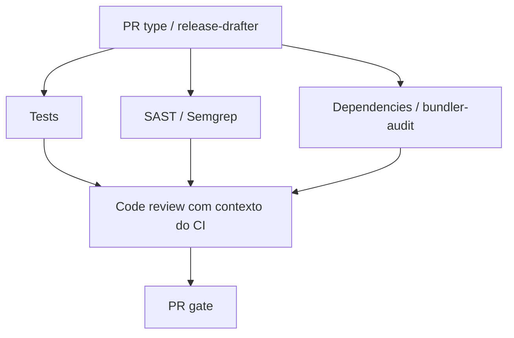

# Pipeline de pull requests e code review

O workflow [Pull request pipeline](../.github/workflows/pull-request.yaml) organiza
as verificações em jobs separados e usa **PR gate** como resultado consolidado.
Configure apenas esse nome como check obrigatório no ruleset da `master`.
Os jobs e o relatório detalhado dos testes continuam visíveis para diagnóstico.

## Sequência e evidências

1. **PR type:** valida `type(context): description`. O release-drafter executa
   somente a classificação por labels (`disable-releaser: true`), sem criar ou
   atualizar releases em PRs. A geração real do draft permanece no push da `master`.
2. **Tests:** executa RSpec no Ruby 2.6.2 com nomes dos cenários nos logs,
   gera JSON/JUnit e publica todos os cenários via `dorny/test-reporter`.
3. **SAST** e **Dependencies:** rodam em paralelo com os testes. Semgrep usa o
   conjunto mantido `p/ruby`, sem instalar gems da aplicação. O bundler-audit
   verifica o lockfile da base e do PR contra a mesma base de advisories atualizada.
   Compara gem/advisory, registra a dívida preexistente e bloqueia vulnerabilidades
   introduzidas de severidade média ou maior, severidade desconhecida e fontes
   inseguras. Baixas ficam no relatório. Erros de instalação, rede ou análise
   falham o job. O scanner usa Ruby 3.3 em job próprio; a aplicação e seus testes
   continuam no Ruby 2.6.2. Nenhum Gemfile é avaliado ou bundle da aplicação instalado
   pelo scanner. Não depende de habilitar Dependency graph no GitHub.
4. **Code review:** aguarda esses três jobs, inclusive quando falham. Baixa os
   relatórios da mesma execução, prepara `ci-context.json` com seus resultados,
   nomes/status de cada teste, falhas, pendências, SAST e dependências. O modelo
   recebe esse contexto e o diff exato do SHA do PR como anexos. Artefatos ausentes
   são identificados explicitamente; nunca contam como análise aprovada.
5. **PR gate:** exige validação, testes, SAST e dependências bem-sucedidos. Para
   PRs com revisão automatizada disponível, também exige análise concluída e
   review publicado, sem solicitação de alterações. Um comentário por achados
   somente médios não reprova o gate se as demais verificações estiverem verdes.

A configuração [Dependabot](../.github/dependabot.yml) abre PRs semanais para
Bundler e GitHub Actions, com títulos Conventional Commits. O Dependabot não
é um scanner executado dentro de cada PR; essa função é da auditoria do lockfile.
A configuração passa a vigorar depois de chegar à branch padrão.

O workflow de testes em push da `master` e por acionamento manual continua
separado. O workflow antigo de review é substituído pelo pipeline para evitar
revisões duplicadas. Alterações no título do PR também disparam a validação.

## Modelo, perfil e decisão formal

O pipeline usa o OpenCode CLI **1.2.19**, instalado da release oficial com
verificação SHA-256, e o modelo `opencode/big-pickle`. A versão é fixa para
preservar o contrato de execução e os eventos JSON. Um servidor HTTP local é
iniciado e verificado antes de conectar o cliente com `run --attach`, evitando
o transporte interno do CLI. Atualizações automáticas e buscas adicionais do
catálogo de modelos ficam desabilitadas nesse job. A execução do modelo é
não interativa, tem limite de dez minutos e registra apenas marcos de progresso
nos logs, sem imprimir argumentos, respostas do modelo ou conteúdo das ferramentas. O CLI recebe explicitamente
`--agent code-reviewer`, registrado em [opencode.json](../opencode.json), com
as regras em [code-reviewer](../.agents/agents/code-reviewer.md).

A resposta final do modelo é JSON, extraída dos eventos `text` do CLI e validada
antes de usar a API de reviews. O workflow determina o evento:

| Achados e evidências | Review formal |
| --- | --- |
| Algum achado crítico ou alto confirmado | Solicitar alterações (`REQUEST_CHANGES`) |
| Apenas achados médios | Comentar (`COMMENT`) |
| Sem achados ou apenas baixos, com análise completa e CI verde | Aprovar (`APPROVE`) |
| Análise incompleta ou verificações sem sucesso, sem alto/crítico | Comentar, sem aprovação |

O resumo e os achados ficam visíveis no review. Comandos, versões, limitações e
links pertinentes ficam no toggle **Detalhes da análise**. O perfil exige
reproduzir ou confirmar a semântica antes de repetir um alerta; comentários de
execuções anteriores não são evidência de que o problema ainda existe.

JSON inválido, execução sem decisão, erro do modelo ou rejeição da API falham o
job; não há aprovação por fallback. Antes da publicação, o workflow confere o
SHA atual e associa o review ao SHA analisado. Se o PR mudou ou foi fechado,
a decisão antiga é descartada. Em drafts, uma aprovação vira comentário até o
PR estar pronto. Aprovação não faz merge nem substitui os demais requisitos.

## Configuração no GitHub

1. Cadastre o repository secret `OPENCODE_API_KEY`, com acesso ao Big Pickle.
2. Permita as actions referenciadas no pipeline, incluindo `actions/github-script`,
   `ruby/setup-ruby`, release-drafter e Dorny.
3. Em **Settings → Actions → General → Workflow permissions**, habilite
   **Allow GitHub Actions to create and approve pull requests**, se permitido
   pela organização. O job de review usa `pull-requests: write`.
4. No ruleset da `master`, habilite **Require status checks to pass** e selecione
   somente **PR gate**. Se houver checks antigos obrigatórios, substitua-os por
   esse resultado consolidado. Configure depois da primeira execução do novo check.

Testes e scanners ficam em jobs isolados, sem `OPENCODE_API_KEY`. O job do modelo
não recebe token GitHub no processo do CLI, não executa scripts ou testes do PR
nem instala seu bundle. Apenas o passo de publicação usa o token de review.
Checkout não persiste credenciais. A configuração mantém leitura de código;
a escrita em PRs fica nos jobs de classificação e de publicação de review.

PRs de forks e do Dependabot não recebem o secret do modelo. Neles, testes e
segurança continuam obrigatórios, a revisão automática é dispensada pelo gate
e a revisão humana permanece necessária. Não use `pull_request_target` com
checkout de código do contribuidor para contornar essa restrição.

## Relatórios e diagnóstico

- `pr-test-reports`: JSON/JUnit com todos os testes, inclusive falhas e pendências.
- `pr-sast-reports`: JSON do Semgrep.
- `pr-dependency-reports`: alterações de dependências e vulnerabilidades detectadas.
- `code-review-evidence-<PR>-<tentativa>`: contexto do CI, diff e decisão estruturada,
  com retenção de sete dias. Não publique tokens, sessões ou dados pessoais.

Scanners opcionais do agente seguem o [guia de ferramentas](../.agents/review-tools.md).
Eles complementam a evidência; não executam a aplicação no job com a API key.
Playwright só se aplica a preview autorizado e não é instalado pelo pipeline.

Secret ausente, erro do provedor, rede indisponível ou negação de aprovação pelo
GitHub aparecem explicitamente no job. Reexecutar um workflow antigo reutiliza
sua versão; use uma execução do commit com a correção. Dependências externas e
regras remotas podem ficar indisponíveis, o que reprova a verificação afetada.

Segundo a documentação do OpenCode, dados coletados durante o período gratuito
do Big Pickle podem ser usados para melhorar o modelo. O pipeline não cria
sessões públicas compartilhadas, mas isso não altera a política do provedor.

Referências: [OpenCode CLI](https://opencode.ai/docs/cli/),
[modelos e privacidade](https://opencode.ai/v2/docs/console/models/),
[Semgrep](https://semgrep.dev/docs/semgrep-ci/overview) e
[bundler-audit](https://github.com/rubysec/bundler-audit).
