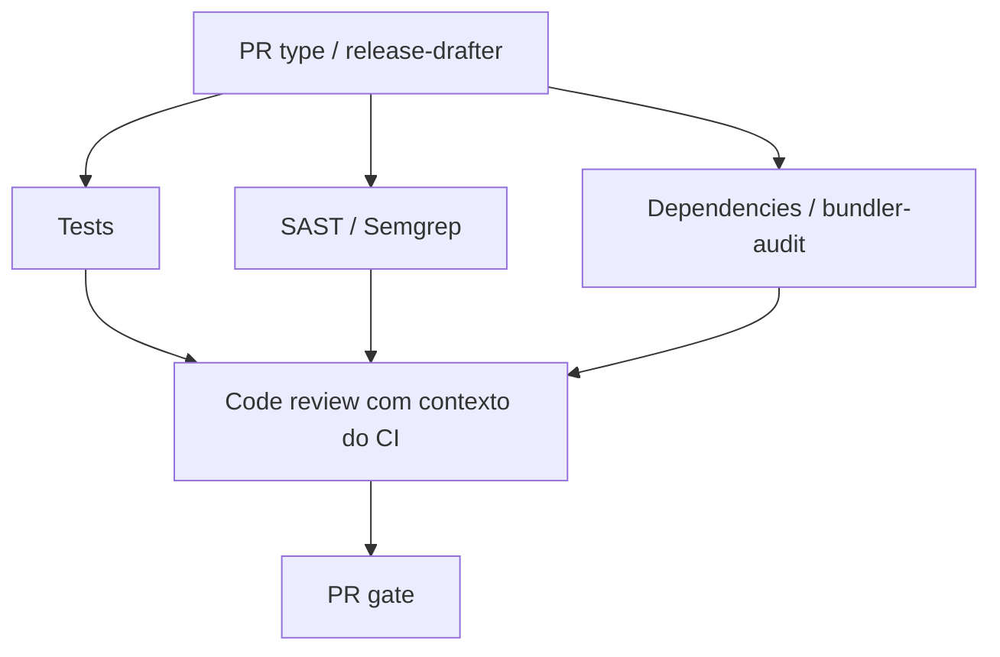

# Pipeline de pull requests e code review

O workflow [Pull request pipeline](../.github/workflows/pull-request.yaml) organiza
as verificações em jobs separados e usa **PR gate** como resultado consolidado.
Configure apenas esse nome como check obrigatório no ruleset da `master`.
Os jobs e o relatório detalhado dos testes continuam visíveis para diagnóstico.

## Sequência e evidências

1. **PR type:** valida `type(context): description`. O release-drafter executa
   somente a classificação por labels (`disable-releaser: true`), sem criar ou
   atualizar releases em PRs. A geração real do draft permanece no push da `master`.
2. **Tests:** executa RSpec no Ruby 2.6.2 com nomes dos cenários nos logs,
   gera JSON/JUnit e publica todos os cenários via `dorny/test-reporter`.
3. **SAST** e **Dependencies:** rodam em paralelo com os testes. Semgrep usa o
   conjunto mantido `p/ruby`, sem instalar gems da aplicação. O bundler-audit
   verifica o lockfile da base e do PR contra a mesma base de advisories atualizada.
   Compara gem/advisory, registra a dívida preexistente e bloqueia vulnerabilidades
   introduzidas de severidade média ou maior, severidade desconhecida e fontes
   inseguras. Baixas ficam no relatório. Erros de instalação, rede ou análise
   falham o job. O scanner usa Ruby 3.3 em job próprio; a aplicação e seus testes
   continuam no Ruby 2.6.2. Nenhum Gemfile é avaliado ou bundle da aplicação instalado
   pelo scanner. Não depende de habilitar Dependency graph no GitHub.
4. **Code review:** aguarda esses três jobs, inclusive quando falham. Baixa os
   relatórios da mesma execução, prepara `ci-context.json` com seus resultados,
   nomes/status de cada teste, falhas, pendências, SAST e dependências. O modelo
   recebe esse contexto e o diff exato dos arquivos revisáveis. README, `docs/` e
   edição de título/descrição não chamam o modelo. Artefatos ausentes são
   identificados explicitamente; nunca contam como análise aprovada.
5. **PR gate:** exige validação, testes, SAST e dependências bem-sucedidos. Para
   PRs com revisão automatizada disponível, também exige análise concluída e
   review publicado, sem solicitação de alterações. Um comentário por achados
   somente médios não reprova o gate se as demais verificações estiverem verdes.

A configuração [Dependabot](../.github/dependabot.yml) abre PRs semanais para
Bundler e GitHub Actions, com títulos Conventional Commits. O Dependabot não
é um scanner executado dentro de cada PR; essa função é da auditoria do lockfile.
A configuração passa a vigorar depois de chegar à branch padrão.

O workflow de testes em push da `master` e por acionamento manual continua
separado. O workflow antigo de review é substituído pelo pipeline para evitar
revisões duplicadas. Alterações no título do PR também disparam a validação.

## Revisão curta com fallback explícito

O pipeline usa a action oficial do OpenCode, sem API direta, nesta ordem:

1. `opencode/big-pickle`;
2. `opencode/beam-free`;
3. `opencode-go/deepseek-v4.1-flash`;
4. `opencode-go/gpt-6-luna`.

Cada tentativa só acontece quando a anterior falha, expira ou não publica JSON
válido para o SHA do PR. Uma resposta estruturada válida, inclusive com análise
incompleta, encerra a cadeia e segue a política de comentário seguro. DeepSeek e
GPT-6 Luna exigem uma credencial de assinatura OpenCode Go em `OPENCODE_API_KEY`.
Se nenhuma tentativa gerar decisão válida, o job falha e nenhuma aprovação é enviada.

O [perfil curto](../.agents/agents/code-reviewer.md) recebe o diff e o resumo do
CI. Em [opencode.json](../opencode.json), `steps: 1` limita o agente a uma rodada
de análise, todas as ferramentas estão desativadas e nenhuma permissão de
shell, leitura adicional, navegação, edição ou delegação é concedida. O agente
não repete scanners nem consome comentários anteriores como evidência.

- **Uma rodada do agente principal**, sem ciclos de ferramentas.
- **Um minuto por modelo e cinco minutos para o job inteiro**, sem retries do
  workflow para o mesmo modelo.
- **2.000 tokens de saída** no limite do modelo. JSON incompleto não é aceito.
- **100 KB de contexto preparado pelo pipeline**, sem truncar o diff silenciosamente.
  PRs maiores devem ser divididos ou revisados manualmente; não são autoaprovados.
- Contagens de testes e somente falhas/pendências, achados SAST e dependências
  introduzidas são enviados. Até dez detalhes por categoria; contagens e omissões
  são explícitas. Os resultados completos permanecem nos artefatos.
- `Gemfile.lock` fica fora do prompt: sua análise pertence ao job de dependências.
  O prompt contém somente Ruby, ERB, CSS/JS, testes, scripts, configurações de
  execução e automações do GitHub. README, `docs/` e demais arquivos não
  revisáveis não invalidam o cache.

A action pode incluir metadados/histórico do PR e fazer operações internas de sessão;
`steps: 1` não promete exatamente uma requisição de rede. O limite de 100 KB vale
para o contexto montado pelo workflow, não para todo o protocolo do cliente.
O uso efetivo de tokens é consultado no OpenCode; o workflow registra orçamento,
tamanho de entrada e acerto de cache em `review-metadata.json`.

O pipeline extrai apenas o JSON publicado pelo bot para a execução atual, valida
o schema e publica um review legível. Comentários temporários inválidos e a
resposta estruturada selecionada são removidos após a publicação formal. O
artefato registra o resultado e o motivo de cada fallback.

### Reutilização sem nova análise

O review publicado contém uma marca de cache com hash da base, HEAD, estratégia,
cadeia de modelos, perfil e contexto compacto do CI. A reutilização aceita apenas a última revisão
do bot para o mesmo HEAD, com análise completa e hash idêntico. Não usa comentários
de usuários nem reviews descartados. Tempo de teste e ordem aleatória dos cenários
não alteram o hash; uma mudança na base, código, política ou resultados o invalida.

Assim, editar título/descrição não chama a IA. Repetir uma execução com o mesmo
diff revisável reutiliza a decisão e não publica reviews duplicados. Quando não há
arquivo revisável, o `PR gate` aceita explicitamente a revisão dispensada; os jobs
determinísticos continuam obrigatórios.

### Decisão formal

| Achados e evidências | Review formal |
| --- | --- |
| Algum achado crítico ou alto confirmado | Solicitar alterações (`REQUEST_CHANGES`) |
| Apenas achados médios | Comentar (`COMMENT`) |
| Sem achados ou apenas baixos, com análise completa e CI verde | Aprovar (`APPROVE`) |
| Análise incompleta ou verificações sem sucesso, sem alto/crítico | Comentar, sem aprovação |

O resumo e os achados ficam no review, associados ao SHA analisado. O modelo não
escolhe o evento, não executa código e não recebe ferramentas. A publicação é um
passo separado com validação estrita. Se o PR mudar ou fechar durante a execução,
a decisão antiga é descartada. Em drafts, a aprovação é adiada com comentário.
Uma análise incompleta ou pedido de alterações reprova o `PR gate`.

## Configuração no GitHub

1. Cadastre o repository secret `OPENCODE_API_KEY`, com acesso ao Big Pickle e à
   assinatura OpenCode Go para os fallbacks DeepSeek e GPT-6 Luna.
2. Permita as actions referenciadas no pipeline, incluindo `actions/github-script`,
   `ruby/setup-ruby`, `anomalyco/opencode/github`, release-drafter e Dorny.
3. Em **Settings → Actions → General → Workflow permissions**, habilite
   **Allow GitHub Actions to create and approve pull requests**, se permitido
   pela organização. O job de review usa `pull-requests: write`.
4. No ruleset da `master`, habilite **Require status checks to pass** e selecione
   somente **PR gate**. Se houver checks antigos obrigatórios, substitua-os por
   esse resultado consolidado. Configure depois da primeira execução do novo check.

Testes e scanners ficam em jobs isolados, sem `OPENCODE_API_KEY`. O job do modelo
não executa scripts ou testes do PR nem instala seu bundle. A action usa o token GitHub para a resposta temporária e o passo separado
publica o review formal. O modelo não possui ferramentas para acessar o token
ou o ambiente; o job não tem permissão para push. Nenhum script do PR é executado
com as credenciais do provedor.
Checkout não persiste credenciais. A configuração mantém leitura de código;
a escrita em PRs fica nos jobs de classificação e de publicação de review.

PRs de forks e do Dependabot não recebem o secret do modelo. Neles, testes e
segurança continuam obrigatórios, a revisão automática é dispensada pelo gate
e a revisão humana permanece necessária. Não use `pull_request_target` com
checkout de código do contribuidor para contornar essa restrição.

## Relatórios e diagnóstico

- `pr-test-reports`: JSON/JUnit com todos os testes, inclusive falhas e pendências.
- `pr-sast-reports`: JSON do Semgrep.
- `pr-dependency-reports`: alterações de dependências e vulnerabilidades detectadas.
- `code-review-evidence-<PR>-<tentativa>`: contexto compacto, escopo de arquivos,
  diff, requisição sem credenciais, tentativas/fallbacks, decisão e orçamento/cache,
  com retenção de sete dias. Não publique tokens, sessões ou dados pessoais.

A revisão automática não executa scanners opcionais nem Playwright. Verificações
interativas adicionais podem seguir o [guia de ferramentas](../.agents/review-tools.md)
fora desse job. O pipeline mantém as análises determinísticas em jobs isolados.

Secret ausente, erro do provedor, rede indisponível ou negação de aprovação pelo
GitHub aparecem explicitamente no job. Reexecutar um workflow antigo reutiliza
sua versão; use uma execução do commit com a correção. Dependências externas e
regras remotas podem ficar indisponíveis, o que reprova a verificação afetada.

Segundo a documentação do OpenCode, dados coletados durante o período gratuito
do Big Pickle podem ser usados para melhorar o modelo. O pipeline não cria
sessões públicas compartilhadas, mas isso não altera a política do provedor.

Referências: [OpenCode CLI](https://opencode.ai/docs/cli/),
[modelos e privacidade](https://opencode.ai/v2/docs/console/models/),
[Semgrep](https://semgrep.dev/docs/semgrep-ci/overview) e
[bundler-audit](https://github.com/rubysec/bundler-audit).
